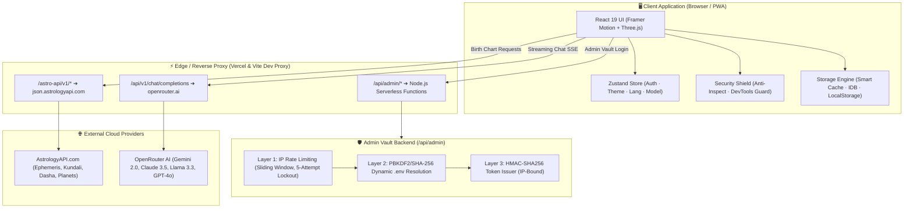
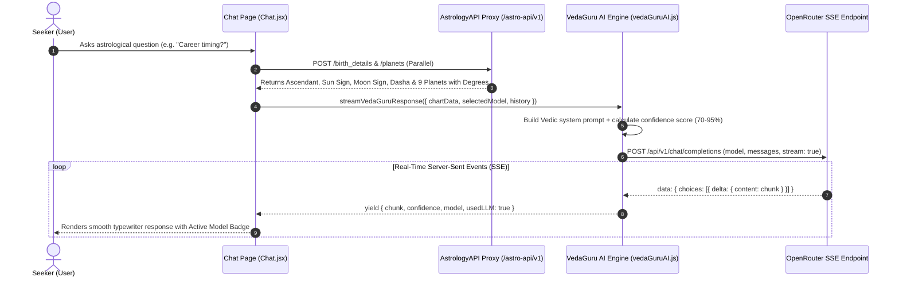
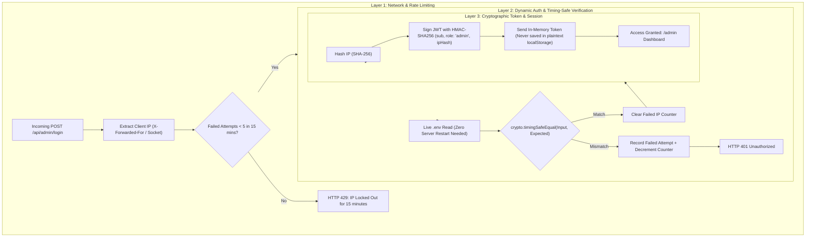

# 🔮 VedAstro (v2.0.5)

> **Ancient Vedic Wisdom · Modern Digital Precision**  
> A high-performance, security-hardened Vedic Astrology Progressive Web Application (PWA) powered by **React 19**, **Vite 5**, **Tailwind CSS 4**, live ephemeris via **AstrologyAPI.com**, and an intelligent **OpenRouter AI Engine** (supporting Gemini 2.0 Flash Free, Claude 3.5 Sonnet, Llama 3.3, and GPT-4o).


---

## 📑 Table of Contents

1. [System Architecture Diagram](#-system-architecture-diagram)
2. [AI Chat Engine & Planetary Data Flow](#-ai-chat-engine--planetary-data-flow)
3. [3-Layer Admin Security Architecture](#-3-layer-admin-security-architecture)
4. [Project Directory Subtree](#-project-directory-subtree)
5. [Key Features](#-key-features)
6. [Supported AI Models](#-supported-ai-models)
7. [Production Build & Code Obfuscation](#-production-build--code-obfuscation)
8. [Environment Setup & Configuration](#-environment-setup--configuration)
9. [Development & Deployment Guide](#-development--deployment-guide)

---

## 🏛️ System Architecture Diagram



---

## 🧠 AI Chat Engine & Planetary Data Flow

Unlike generic AI wrappers that hallucinate astronomical data, **VedaGuru** computes authentic ephemeris positions first, then provides complete chart context to the LLM:



---

## 🛡️ 3-Layer Admin Security Architecture



---

## 📂 Project Directory Subtree

```
vedastroapp/
├── 📁 .agents/                       # Antigravity agent configuration & skills
│   └── 📁 skills/                   # Audited agent capabilities (OWASP ASI Safe)
├── 📁 api/                           # Vercel Serverless Backend Functions
│   ├── 📁 _lib/                     # Shared backend utilities
│   │   ├── jwt.js                   # HMAC-SHA256 JWT sign & verify
│   │   └── rateLimit.js             # Sliding-window IP rate limiter
│   └── 📁 admin/                    # Admin vault endpoints
│       ├── login.js                 # Dynamic .env authentication handler
│       ├── logout.js                # Server session revocation
│       └── verify.js                # Token & IP hash verification
├── 📁 public/                        # Static assets, SVG icons & PWA manifest
├── 📁 src/                           # Frontend React Application
│   ├── 📁 api/                      # Client-side API orchestration
│   │   ├── astrologyApi.js          # Compulsory AstrologyAPI wrapper & birth math
│   │   └── vedaGuruAI.js            # OpenRouter SSE streaming generator
│   ├── 📁 components/               # Modular UI components
│   │   ├── 📁 cards/                # DashaCard, PlanetCard, TransitCard
│   │   ├── 📁 chat/                 # ChatBubble, TypingIndicator, QuickChips
│   │   ├── 📁 layout/               # Navbar, Sidebar, BottomNav
│   │   ├── 📁 three/                # Three.js celestial & zodiac canvas
│   │   └── 📁 ui/                   # GlassCard, GoldButton, ThemeToggle
│   ├── 📁 context/                  # React Context providers (Auth, Lang, Theme)
│   ├── 📁 db/                       # Client database layers
│   │   ├── adminDatabase.js         # In-memory JWT admin client
│   │   ├── predictionDB.js          # Saved predictions database
│   │   └── userDatabase.js          # Seeker profiles (IndexedDB)
│   ├── 📁 pages/                    # Route views
│   │   ├── Admin.jsx                # Full Admin Dashboard (Stats, Users, Security)
│   │   ├── AdminLogin.jsx           # Standalone Admin Vault authentication gate
│   │   ├── BirthChart.jsx           # Kundali chart renderer & planetary degrees
│   │   ├── Chat.jsx                 # VedaGuru AI Chat with Model Picker
│   │   ├── Home.jsx                 # Dashboard with live API status & planetary summary
│   │   ├── Horoscope.jsx            # Daily & monthly sun/moon sign horoscopes
│   │   ├── Kundali.jsx              # North/South Indian kundali visualizer
│   │   ├── Login.jsx                # Seeker user login & registration
│   │   ├── Match.jsx                # 36-Guna Ashtakoot matrimonial compatibility
│   │   ├── Numerology.jsx           # Pythagorean & Chaldean numerology calculator
│   │   ├── Panchang.jsx             # Daily Tithi, Nakshatra, Yoga, Karana, Rahu Kaal
│   │   ├── Settings.jsx             # Language, theme, model picker, API keys
│   │   ├── TodoList.jsx             # Watermelon 3D live todo with astrology tips
│   │   └── Welcome.jsx              # Onboarding landing page
│   ├── 📁 router/                   # React Router v7 routes & protected gates
│   ├── 📁 store/                    # Zustand global store (useAppStore.js)
│   └── 📁 utils/                    # Helper libraries
│       ├── aiModels.js              # Curated OpenRouter models catalog
│       ├── banSystem.js             # Device anomaly detection
│       ├── dashaCalculator.js       # Vimshottari period mathematics
│       ├── securityGuard.js         # Anti-inspection & DevTools shield
│       └── storage.js               # TTL-aware smart cache & storage manager
├── .env.example                     # Sanitized environment template
├── package.json                     # Project manifest & dependencies
├── vercel.json                      # Vercel serverless rewrites & routing
└── vite.config.js                   # Vite 5 + Terser obfuscation + Hashed Chunks
```

---

## ⚡ Supported AI Models

VedAstro gives seekers full freedom to choose their AI engine. Select your model directly from the **Chat header** or **Settings**:

| Model Name | Provider | Model ID | Tier | Best For |
|:---|:---|:---|:---:|:---|
| **Gemini 2.0 Flash** | Google | `google/gemini-2.0-flash-001:free` | 🟢 **100% Free** | Blazing-fast astrological consultations & remedies |
| **Llama 3.3 70B** | Meta | `meta-llama/llama-3.3-70b-instruct:free` | 🟢 **100% Free** | Deep textual reasoning & classical Sanskrit analysis |
| **DeepSeek R1** | DeepSeek | `deepseek/deepseek-r1:free` | 🟢 **100% Free** | Step-by-step astrological deduction |
| **Mistral 7B** | Mistral | `mistralai/mistral-7b-instruct:free` | 🟢 **100% Free** | Concise daily predictions |
| **Claude 3.5 Haiku** | Anthropic | `anthropic/claude-3.5-haiku` | 💎 Premium | High-speed, nuanced psychological astrology |
| **Claude 3.5 Sonnet** | Anthropic | `anthropic/claude-3.5-sonnet` | 💎 Flagship | Unmatched depth, poetic wisdom & philosophical guidance |
| **GPT-4o Mini** | OpenAI | `openai/gpt-4o-mini` | 💎 Standard | Balanced, structured life path breakdowns |
| **GPT-4o** | OpenAI | `openai/gpt-4o` | 💎 Flagship | Multidisciplinary synthesis & cross-chart comparison |

---

## 🔒 Production Build & Code Obfuscation

To protect intellectual property, API boundaries, and sensitive application logic, VedAstro implements production-grade bundling in [`vite.config.js`](file:///d:/phython/Antigravity/vedastroapp/vite.config.js):

1. **Zero Source Maps**: `sourcemap: false` is permanently enforced. DevTools cannot download `.map` files or reconstruct source code.
2. **Anonymous 16-Character Cryptographic Hashes**: Rollup chunk names output to `assets/[hash:16].js`. Files like `Admin.jsx`, `Chat.jsx`, or `userDatabase.js` are never exposed in Network or Sources tabs (e.g. `assets/DW9DnWyarGstmsuJ.js`).
3. **Terser Obfuscation**:
   * All `console.log`, `console.info`, `console.debug`, and `debugger` statements are stripped.
   * `toplevel: true` mangles internal variables and function signatures into unreadable single-character identifiers.
   * `comments: false` eliminates all copyright and descriptive comments.
4. **Client-Side Anti-Tamper Shield** ([`src/utils/securityGuard.js`](file:///d:/phython/Antigravity/vedastroapp/src/utils/securityGuard.js)):
   * Disables right-click context menu inspection on production builds.
   * Blocks developer shortcuts (`F12`, `Ctrl+Shift+I`, `Ctrl+Shift+J`, `Ctrl+Shift+C`, `Ctrl+U`).
   * Displays an anti-tamper security warning banner in the browser console.

---

## ⚙️ Environment Setup & Configuration

Create your `.env` file from `.env.example`:

```bash
cp .env.example .env
```

Configure your credentials:

```env
# ── 1. Astrology API (COMPULSORY for chart calculations & planetary data) ──
VITE_ASTRO_API_KEY=ak-your-astrologyapi-access-token
VITE_ASTRO_USER_ID=your-user-id

# ── 2. OpenRouter AI (For live VedaGuru chat) ──
VITE_OPENROUTER_API_KEY=sk-or-v1-your-openrouter-key
VITE_OPENROUTER_MODEL=google/gemini-2.0-flash-001:free


VITE_APP_VERSION=2.0.5
VITE_SENTRY_DSN=
```


## 🚀 Development & Deployment Guide

### Local Development

```bash
# 1. Install dependencies
npm install

# 2. Run local development server
npm run dev
```

* App URL: `http://localhost:5173`


### Production Verification Build

```bash
# Compile and verify all modules with Terser obfuscation
npm run build

# Preview production build locally
npm run dev
```

### Vercel Deployment

1. Push your repository to GitHub / GitLab.
2. Link the repository in the **Vercel Dashboard**.
3. Add environment variables in **Project Settings → Environment Variables**:
    * `VITE_ASTRO_API_KEY`
   * `VITE_ASTRO_USER_ID`
   * `VITE_OPENROUTER_API_KEY`
   * `VITE_OPENROUTER_MODEL`
4. Deploy! Vercel automatically deploys both the frontend Vite build and the `/api` serverless backend handlers.

---

## 📄 License

Distributed under the **MIT License**. See `LICENSE` for details.

© 2026 **VedAstro Project** — Ancient Vedic Wisdom & Modern Digital Precision.
